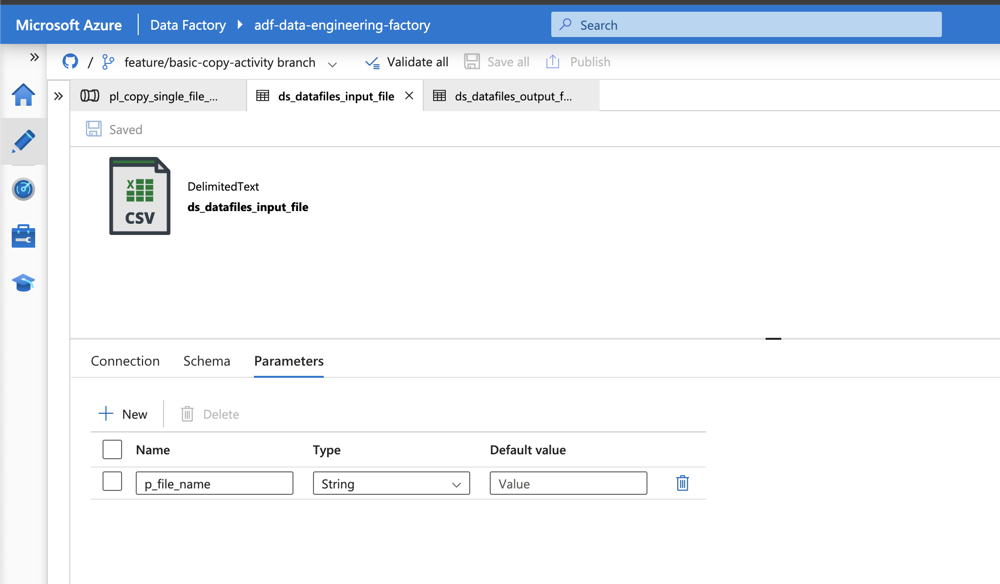
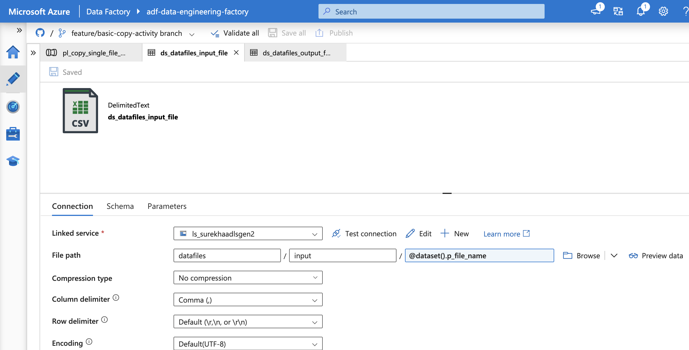
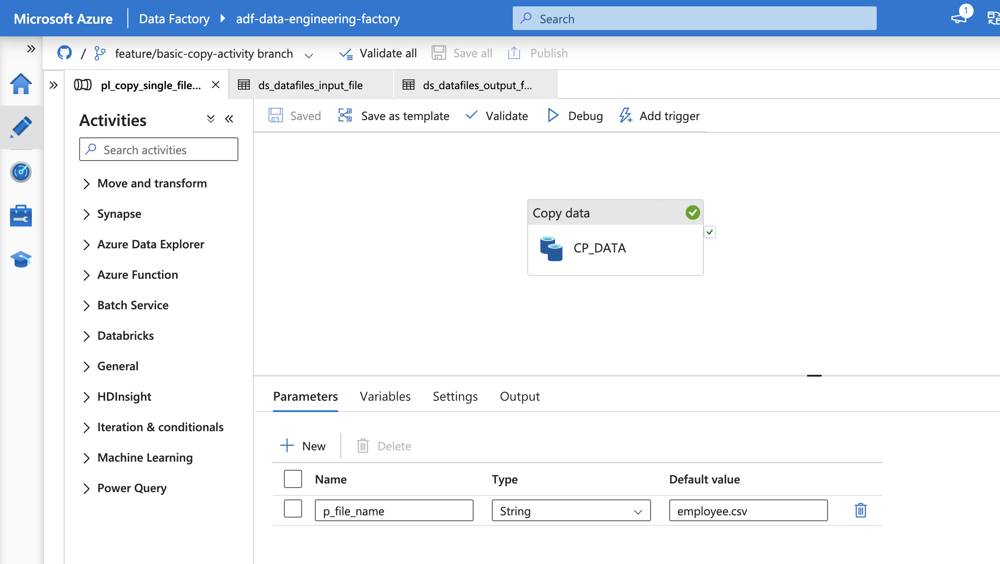
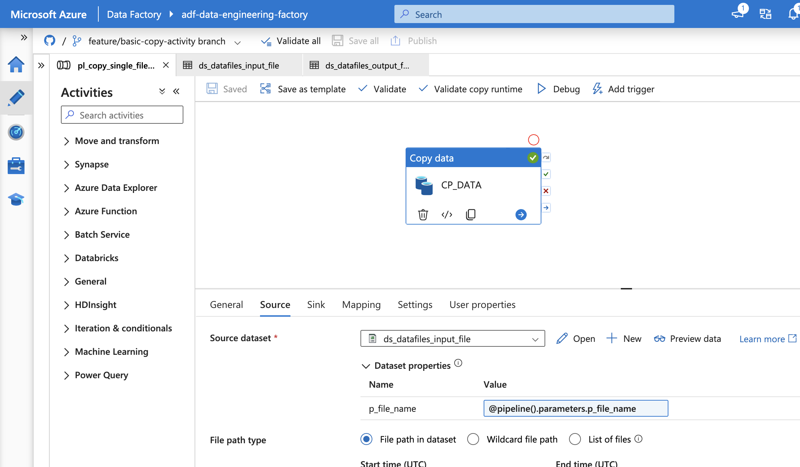
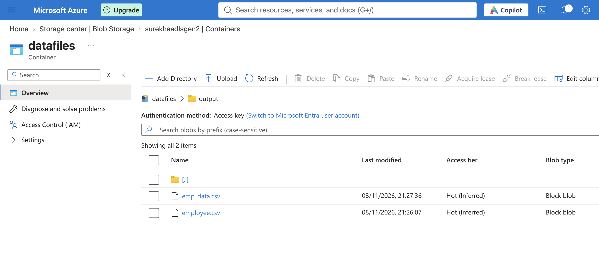

# 01 - Basic File Copy using Azure Data Factory

## 1. Overview

This project demonstrates file movement using Azure Data Factory (ADF) and Azure Data Lake Storage Gen2 (ADLS Gen2).

Two implementations are covered:
- Copying a single file using a predefined file path.
- Copying a file using a dynamic file-name parameter.

**Objective:** Understand ADF linked services, datasets, Copy activity and pipeline parameters.

## 2. Architecture

The following diagram illustrates data movement between the source and destination in ADLS Gen2 through Azure Data Factory.


## 3. Azure Services and Components

| Component | Purpose |
|---|---|
| Azure Data Factory | Orchestrates data movement |
| Azure Data Lake Storage Gen2 | Stores source and destination files |
| Linked Service | Establishes the connection between ADF and ADLS Gen2 |
| Source Dataset | Defines the input file location |
| Sink Dataset | Defines the destination file location |
| Copy Activity | Performs the file copy operation |

## 4. Authentication

The pipelines use the Data Factory System-assigned Managed Identity to authenticate with ADLS Gen2.

The managed identity is granted the `Storage Blob Data Contributor` role on the storage account.

This avoids storing storage account keys or credentials in the linked service.

## 5. Pipeline Implementations

### 5.1 Copy Single File (Without Parameters)

**Pipeline name:** `pl_copy_single_file`

Copies a file from a predefined source location to a predefined destination location using the Copy Data activity.

**Implementation:**
1. Created linked services to connect to ADLS Gen2.
2. Created source and sink datasets with predefined file paths.
3. Added and configured a Copy Data activity.
4. Executed the pipeline and verified the copied file.

**Pipeline design**


**Source configuration**


**Sink configuration**


**Execution and output verification**


### 5.2 Copy Single File (With File-Name Parameter)

The pipeline was enhanced to accept a file name dynamically, allowing different files to be copied without modifying the dataset configuration.

**Implementation:**
1. Created a dataset parameter named `fileName`.
2. Added a dataset parameter variable to dynamically reference the file name.
3. Created a pipeline parameter named `fileName`.
4. Passed the pipeline parameter value to the source and sink datasets.
5. Executed the pipeline with a file name and verified the output.

**Dataset parameter**



**Dataset parameterisation**



**Pipeline parameter**



**Passing pipeline parameter to dataset**



**Output verification**



## 6. Key Learnings

- Integrating Azure Data Factory with ADLS Gen2.
- Configuring linked services using managed identity.
- Creating source and sink datasets.
- Implementing Copy Data activities.
- Using dataset and pipeline parameters for dynamic file selection.
- Monitoring and validating pipeline execution.
- Integrating ADF with GitHub for version control.

## 7. Possible Enhancements

- Copy multiple files from a folder.
- Use wildcard file selection.
- Implement error handling and retry policies.
- Introduce parallel file processing.


## 8. Repository Structure

ADF pipeline and related dataset and linked service definitions are maintained under the `adf/` directory.

Documentation and supporting screenshots are maintained under:

```text
docs/
└── 01-basic-copy-single-file/
    ├── README.md
    ├── architecture.png
    └── screenshots/
        ├── 01-pipeline-design.png
        ├── 02-copy-configuration_source.png
        ├── 02-copy-configuration_target.png
        ├── 03-pipeline-execution.png
        ├── 04-output-verification.png
        ├── 06-dataset-parameter.png
        ├── 07-dataset-parameter-variable.png
        ├── 08-pipeline-parameter.png
        ├── 09-pipeline-parameter-variable.png
        └── 10-output-verification.png