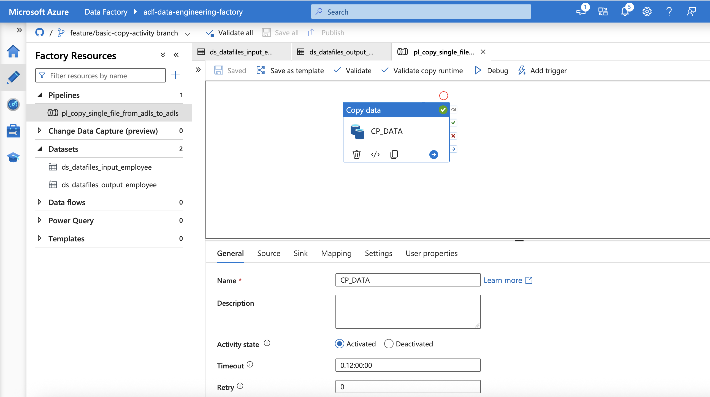
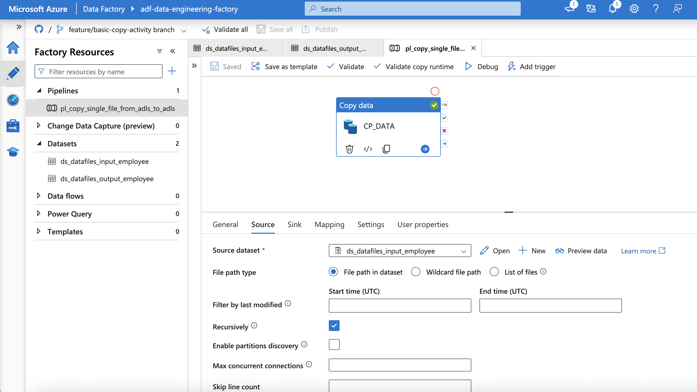
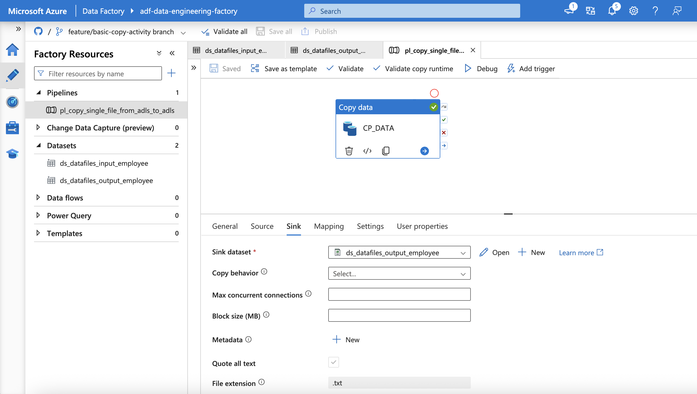
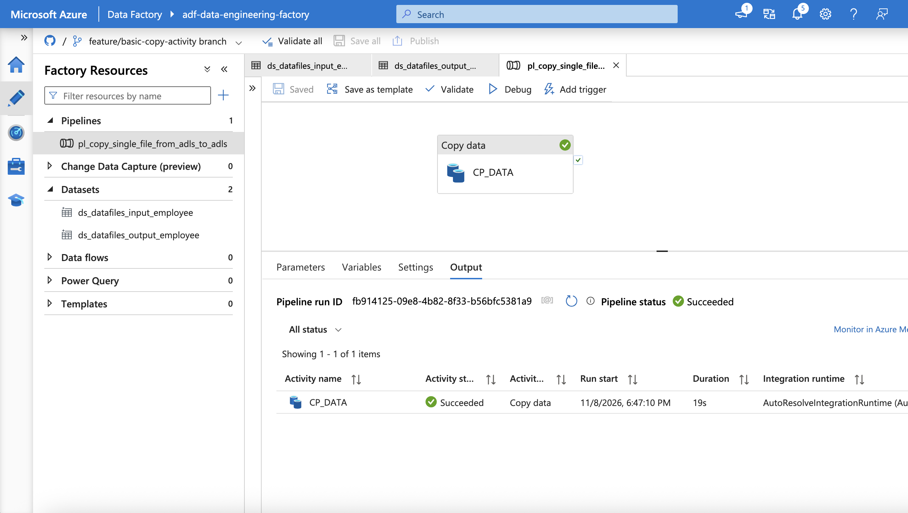
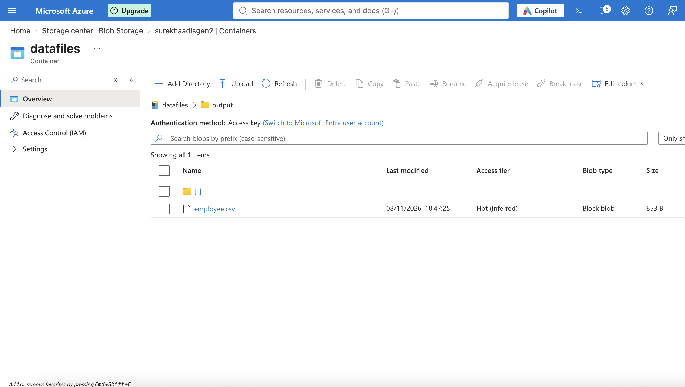

# 01 - Basic Single File Copy using Azure Data Factory

## 1. Overview

This project demonstrates a basic data movement pipeline using Azure Data Factory (ADF).

The pipeline copies a single file from a source folder in Azure Data Lake Storage Gen2 (ADLS Gen2) to a destination folder within the same storage account.

**Objective:** Understand the fundamentals of data integration using ADF, including linked services, datasets and Copy activity.

## 2. Architecture

The following diagram illustrates how data moves from the source to the destination through Azure Data Factory.


## 3. Azure Services and Components

| Component | Purpose |
|---|---|
| Azure Data Factory | Orchestrates the data movement |
| Azure Data Lake Storage Gen2 | Stores source and destination files |
| Linked Service | Establishes the connection between ADF and ADLS Gen2 |
| Source Dataset | Defines the input file location |
| Sink Dataset | Defines the destination folder |
| Copy Activity | Performs the file copy operation |

## 4. Authentication

The pipeline uses the Data Factory System-assigned Managed Identity to authenticate with ADLS Gen2.

The managed identity is granted the `Storage Blob Data Contributor` role on the storage account.

This approach avoids storing storage account keys or credentials in the linked service.

## 5. Pipeline Implementation

**Pipeline name:** `pl_copy_single_file`

**Activity:** Copy Data

**Source:** ADLS Gen2 input folder

**Destination:** ADLS Gen2 output folder

The Copy activity uses the source and sink datasets to determine where to read and write the file.

### 5.1 Pipeline Design

The following screenshot shows the pipeline created in ADF Studio.



### 5.2 Copy Activity Configuration

**Source configuration**



**Sink configuration**



## 6. Execution and Validation

The pipeline is triggered manually from ADF Studio.

### 6.1 Pipeline Execution

The Monitor view provides execution details, including the pipeline run status and Copy activity results.



### 6.2 Output Verification

The destination folder in ADLS Gen2 is checked to verify that the file was copied successfully.



## 7. Key Learnings

- Creating and configuring an Azure Data Factory instance.
- Integrating ADF with ADLS Gen2.
- Configuring linked services using managed identity authentication.
- Creating source and sink datasets.
- Configuring and executing a Copy activity.
- Monitoring pipeline execution.
- Integrating ADF with GitHub for version control.

## 8. Possible Enhancements

- Copy multiple files from a folder.
- Parameterise source and destination paths.
- Use wildcard file selection.
- Implement error handling and retry policies.
- Introduce parallel file processing.

## 9. Repository Structure

ADF pipeline and related dataset and linked service definitions are maintained under the `adf/` directory.

Documentation and supporting screenshots are maintained under:

```text
docs/
└── 01-basic-copy-single-file/
    ├── README.md
    ├── architecture.png
    └── screenshots/
        ├── 01-pipeline-design.png
        ├── 02-copy-configuration_source.png
        ├── 02-copy-configuration_target.png
        ├── 03-pipeline-execution.png
        └── 04-output-verification.png
```