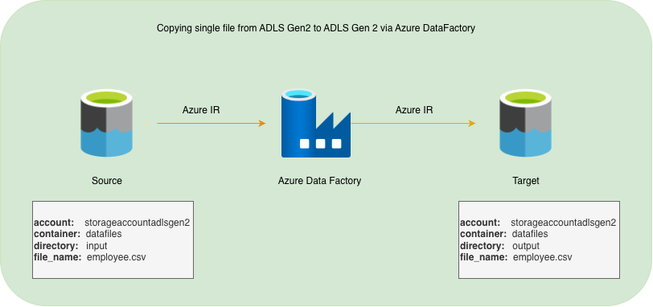

# 01 - Basic Single File Copy using Azure Data Factory

## 1. Overview

This project demonstrates how to build a basic data movement pipeline using Azure Data Factory (ADF).

The pipeline copies a single file from a source folder in Azure Data Lake Storage Gen2 (ADLS Gen2) to a destination folder within the same storage account.

**Objective:** Understand the fundamentals of data integration using ADF, including linked services, datasets and Copy activity.

## 2. Architecture

### Data Flow

1. ADF connects to the ADLS Gen2 storage account.
2. The source dataset identifies the input file.
3. The Copy activity reads the file from the source location.
4. The sink dataset identifies the destination folder.
5. The file is copied to the output location.

## 3. Azure Services and Components

| Component | Purpose |
|---|---|
| Azure Data Factory | Orchestrates the data movement |
| Azure Data Lake Storage Gen2 | Stores the source and destination files |
| Linked Service | Establishes the connection between ADF and ADLS Gen2 |
| Source Dataset | Defines the input file location and format |
| Sink Dataset | Defines the output file location and format |
| Copy Activity | Performs the actual file copy |

## 4. Authentication

The pipeline uses the Data Factory System-assigned Managed Identity to authenticate with ADLS Gen2.

The managed identity is granted the `Storage Blob Data Contributor` role on the storage account.

This avoids storing storage account keys or credentials in the linked service.

## 5. Pipeline Implementation

**Pipeline name:** `pl_copy_single_file`

**Activity:** Copy Data

**Source:** ADLS Gen2 input folder

**Destination:** ADLS Gen2 output folder

The Copy activity uses the source and sink datasets to determine where to read and write the file.

## 6. Execution and Validation

The pipeline is executed manually from ADF Studio.

Validation steps:

- Confirm that the pipeline execution status is successful.
- Check the activity execution details in the ADF Monitor section.
- Verify that the copied file exists in the destination folder.
- Compare the source and destination file contents.

## 7. Key Learnings

- Creating an Azure Data Factory instance.
- Integrating ADF with ADLS Gen2.
- Configuring linked services using managed identity.
- Creating source and sink datasets.
- Configuring and executing a Copy activity.
- Understanding ADF Git integration and version control.

## 8. Possible Enhancements

- Copy multiple files from a folder.
- Parameterise source and destination paths.
- Use wildcard file selection.
- Implement error handling and retry policies.
- Introduce parallel file processing.

## 9. Project Resources

ADF pipeline and related dataset and linked service definitions are maintained in the `adf/` directory of this repository.