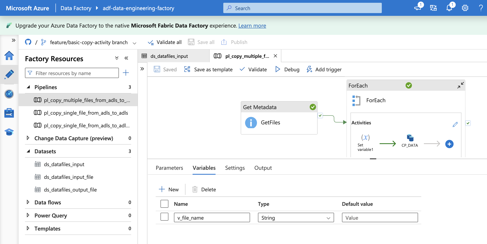
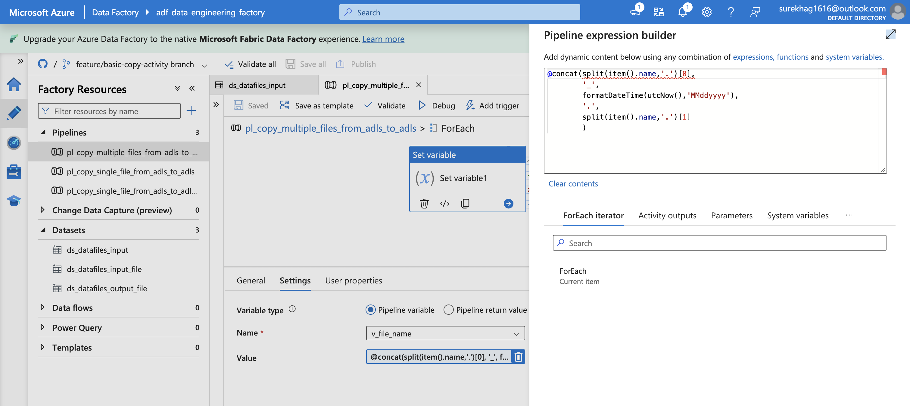
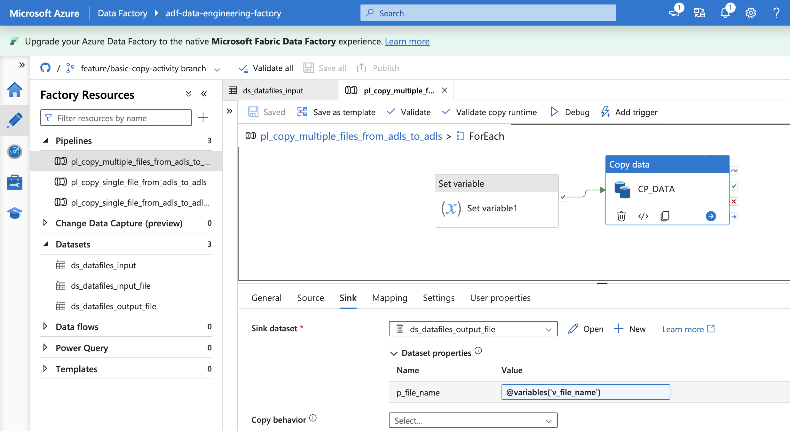
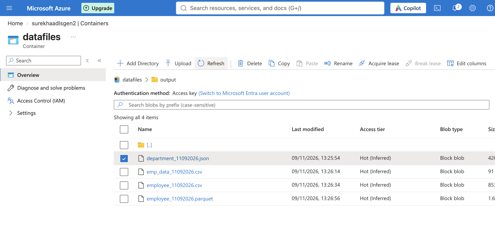

# 02 - Multiple File Copy using Azure Data Factory

## 1. Overview

This project demonstrates how to copy multiple files between Azure Data Lake Storage Gen2 (ADLS Gen2) locations using Azure Data Factory (ADF).

Two implementations are covered:
- Copying multiple files using Get Metadata, ForEach and Copy activities.
- Dynamically renaming destination files by appending the current date to their original file names.

**Objective:** Understand metadata-driven file processing, pipeline iteration, dynamic file naming and variable handling in ADF.

## 2. Azure Services and Components

| Component | Purpose |
|---|---|
| Azure Data Factory | Orchestrates the data movement |
| Azure Data Lake Storage Gen2 | Stores source and destination files |
| Get Metadata | Retrieves file information from the source folder |
| ForEach | Iterates through the files returned by Get Metadata |
| Copy Activity | Copies individual files |
| Set Variable | Stores dynamically generated destination file names |

## 3. Authentication

The pipeline uses the Data Factory System-assigned Managed Identity to authenticate with ADLS Gen2.

The managed identity is granted the `Storage Blob Data Contributor` role on the storage account.

## 4. Pipeline Implementations

### 4.1 Multiple File Copy

Copies multiple files from a source folder to a destination folder in ADLS Gen2.

**Implementation steps:**

1. Configured linked services and datasets for source and destination storage locations.
2. Used Get Metadata to retrieve the list of files in the source folder.
3. Selected the `childItems` field to retrieve the file names.
4. Used ForEach to iterate through the retrieved files.
5. Configured a Copy activity inside ForEach to copy each file to the destination folder.

### 4.2 Multiple File Copy with Dynamic File Naming

Enhanced the pipeline to dynamically rename destination files by appending the current date to the original file name.

For example:

`employee.csv` → `employee_09112026.csv`

**Implementation steps:**

1. Created a pipeline variable to store the destination file name.
2. Used a Set Variable activity inside ForEach to generate the new file name using the original file name and current date.
3. Passed the variable value to the output dataset as the destination file name.
4. Executed the pipeline and verified the renamed files in the destination folder.

**Pipeline variable configuration**



**Get Metadata configuration**


**Dynamic file name generation**



**Output dataset configuration**



**Output validation**



## 5. Key Learnings

- Retrieving file metadata using Get Metadata.
- Using ForEach to iterate over multiple files.
- Implementing metadata-driven file copy operations.
- Using Set Variable to generate dynamic destination file names.
- Passing dynamic values to datasets.
- Monitoring and validating pipeline execution.

## 6. Repository Structure

ADF pipeline and related dataset and linked service definitions are maintained under the `adf/` directory.

Documentation and supporting screenshots are maintained under:

```text
docs/
└── 02-multiple-file-copy/
    ├── README.md
    ├── architecture.png
    └── screenshots/
        ├── 01-pipeline-variable.png
        ├── 02-get-meadata.png
        ├── 03-dynamic-setting-filenames.png
        ├── 04-output-dataset-filename.png
        └── 05-output-validation.png
```