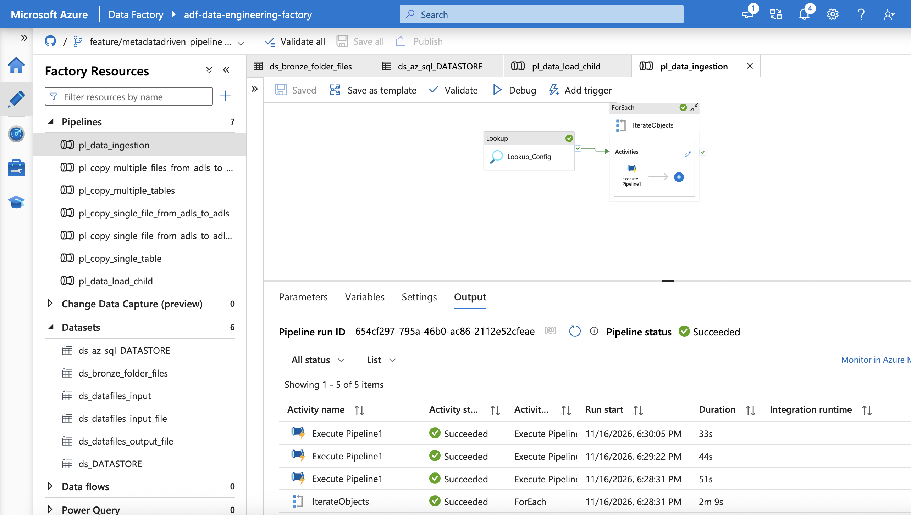
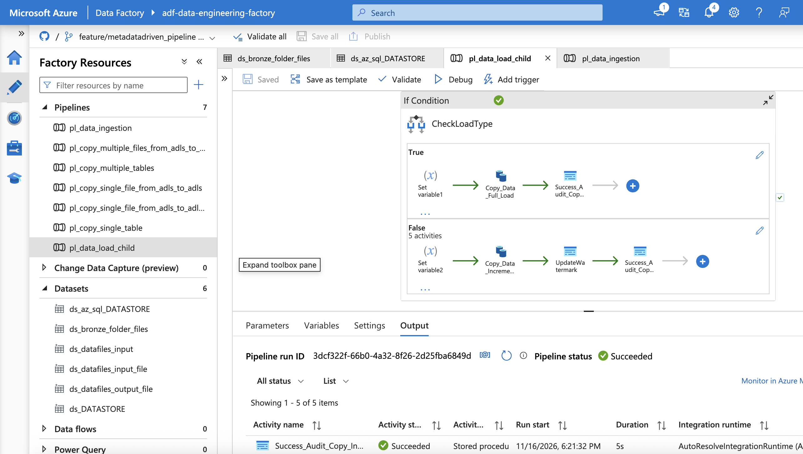

# 04 - Metadata-Driven Full and Incremental Data Ingestion from Azure SQL to ADLS Gen2 using Azure Data Factory

## 1. Overview

This project demonstrates how to build a metadata-driven ingestion framework in Azure Data Factory (ADF) that copies data from Azure SQL Database into the Bronze layer of Azure Data Lake Storage Gen2 (ADLS Gen2).

The framework supports two load types:

- **Full load:** Copies the entire source table on every run.
- **Incremental load:** Copies only new or changed records, using a watermark column.

Every load is logged to an audit table for both success and failure, and the watermark is updated through a stored procedure after a successful incremental load.

The framework is built with two pipelines:

- **Parent pipeline (`pl_data_ingestion`):** Reads the metadata table and calls the child pipeline once for each active table.
- **Child pipeline (`pl_data_load_child`):** Performs the full or incremental load, writes the file to ADLS Gen2, updates the watermark and logs the audit record.

**Objective:** Understand how to build a reusable, scalable ingestion framework where adding a new source table only requires a new row in the metadata table.

## 2. Architecture

### Section 1: Parent pipeline - `pl_data_ingestion`

Orchestrates the ingestion by reading the metadata table and iterating through all active source tables.

**Pipeline flow:**

1. **GetMetadata (Lookup):** Reads all active records from `sales.etl_metadata` and captures the current timestamp as `CurrentWaterMark`.
2. **IterateObjects (ForEach):** Loops through each metadata row sequentially.
3. **Execute Pipeline1 (Execute Pipeline):** Calls `pl_data_load_child` for each table and passes the metadata values as parameters.

### Section 2: Child pipeline - `pl_data_load_child`

Performs the actual data load for one table based on its load type.

**Pipeline flow:**

1. **CheckLoadType (If Condition):** Checks whether `pLoadType` is `Full` or `Incremental`.
2. **Full load (True branch):**
    - **Copy data1:** Copies the entire source table to ADLS Gen2.
    - **SuccessAudit_copy1:** Logs a `Succeeded` audit record if the copy succeeds.
    - **FailureAudit_copy1:** Logs a `Failed` audit record with the error message if the copy fails.
3. **Incremental load (False branch):**
    - **Copy data2:** Copies only records where the watermark column is between `LastWatermark` and `CurrentWaterMark`.
    - **UpdateWaterMark:** Updates the watermark in the metadata table using `usp_UpdateWatermark`.
    - **SuccessAudit:** Logs a `Succeeded` audit record.
    - **FailureAudit:** Logs a `Failed` audit record with the error message.

## 3. Implementation Steps

### Section 1: Set Up the Metadata and Audit Framework

**Step 1: Configure Linked Services and Datasets**

| Component | Name | Purpose |
|---|---|---|
| Linked service | `ls_azSQL_DATASTORE` | Connects to Azure SQL Database |
| Dataset | `ds_azSQL_DSATASTORE` | Source Azure SQL Database |
| Dataset | `ds_bronze_folder_files` | Target ADLS Gen2 Bronze storage |

**Step 2: Create the Metadata Table**

Create `sales.etl_metadata` to control which tables are loaded and how.

| Column Name | Purpose |
|---|---|
| SourceSchema | Source schema name |
| SourceTable | Source table name |
| WatermarkColumn | Column used for incremental loads |
| LastWatermark | Timestamp of the last successful load |
| LoadType | `Full` / `Incremental` |
| TargetPath | Bronze folder location |
| IsActive | Active flag |

Example:

| SourceTable | LoadType | LastWatermark |
|---|---|---|
| Customer | Incremental | 2026-05-20 |
| Orders | Full | NULL |

**Step 3: Create the Stored Procedures**

- `[dbo].[usp_InsertAudit]`: Inserts an audit record for every load.
- `[dbo].[usp_UpdateWatermark]`: Updates `LastWatermark` for a table after a successful incremental load.

Audit information captured:

| Column | Description |
|---|---|
| RunID | Pipeline execution ID |
| SourceTable | Table being processed |
| RowsCopied | Number of rows loaded |
| Status | `Succeeded` / `Failed` |
| ErrorMessage | Failure details |
| StartTime | Load start time |
| EndTime | Load completion time |

### Section 2: Build the Parent Pipeline - `pl_data_ingestion`

**Step 1: Configure the Lookup Activity (GetMetadata)**

- Use the `ds_azSQL_DSATASTORE` dataset.
- Set **First row only = False**.
- Use the following query:

```sql
SELECT
    *,
    GETDATE() AS CurrentWaterMark
FROM sales.etl_metadata
WHERE IsActive = 1
```

- `GETDATE() AS CurrentWaterMark` captures the upper limit of the load window once per run.
- `WHERE IsActive = 1` ensures only active tables are processed.

**Step 2: Configure the ForEach Activity (IterateObjects)**

- Pass the Lookup output to the ForEach items property:

```text
@activity('GetMetadata').output.value
```

- Enable **Sequential** so one table is processed at a time.

**Step 3: Configure the Execute Pipeline Activity (Execute Pipeline1)**

Inside the ForEach, call `pl_data_load_child` and pass the following parameters:

| Child Parameter | Value |
|---|---|
| pSourceSchema | `@item().SourceSchema` |
| pSourceTable | `@item().SourceTable` |
| pWatermarkColumn | `@item().WatermarkColumn` |
| pLastWatermark | `@item().LastWatermark` |
| pCurrentWaterMark | `@item().CurrentWaterMark` |
| pLoadType | `@item().LoadType` |
| pTargetPath | `@item().TargetPath` |

### Section 3: Build the Child Pipeline - `pl_data_load_child`

**Step 1: Define Pipeline Parameters**

Create the seven string parameters listed above: `pSourceSchema`, `pSourceTable`, `pWatermarkColumn`, `pLastWatermark`, `pCurrentWaterMark`, `pLoadType` and `pTargetPath`.

**Step 2: Configure the If Condition Activity (CheckLoadType)**

```text
@equals(pipeline().parameters.pLoadType, 'Full')
```

- **True:** Runs the full load activities.
- **False:** Runs the incremental load activities.

**Step 3: Configure the Full Load (True Branch)**

- Add **Copy data1** with the following source query:

```sql
SELECT * FROM @{pipeline().parameters.pSourceSchema}.@{pipeline().parameters.pSourceTable}
```

- Configure the sink as **Delimited Text (.csv)** with the file name:

```text
@concat(pipeline().parameters.pSourceTable, '.csv')
```

- Connect **SuccessAudit_copy1** (on success) and **FailureAudit_copy1** (on failure) to `usp_InsertAudit`.

**Step 4: Configure the Incremental Load (False Branch)**

- Add **Copy data2** with the following source query:

```sql
SELECT * FROM @{pipeline().parameters.pSourceSchema}.@{pipeline().parameters.pSourceTable}
WHERE @{pipeline().parameters.pWatermarkColumn} > '@{pipeline().parameters.pLastWatermark}'
AND @{pipeline().parameters.pWatermarkColumn} <= '@{pipeline().parameters.pCurrentWaterMark}'
```

- Configure the sink file name with the load date:

```text
@concat(pipeline().parameters.pSourceTable, '_', formatDateTime(utcNow(), 'MMddyyyy'), '.csv')
```

Example output: `Customer_05242026.csv`

- Add **UpdateWaterMark** to call `usp_UpdateWatermark` after a successful copy:

| Parameter | Value |
|---|---|
| NewWatermark | `pCurrentWaterMark` |
| SourceTable | `pSourceTable` |

- Connect **SuccessAudit** (on success) and **FailureAudit** (on failure) to `usp_InsertAudit`.

### Section 4: Execute and Validate

- Trigger `pl_data_ingestion`.
- Verify that the Lookup returns all active tables.
- Check that the ForEach runs the child pipeline once for each table.
- Confirm that full load tables generate `<TableName>.csv` and incremental tables generate `<TableName>_<MMddyyyy>.csv` in ADLS Gen2.
- Query the audit table to confirm `Succeeded` and `Failed` records.
- Confirm that `LastWatermark` is updated only for successful incremental loads.

## 4. Snapshots

**1. Parent Pipeline - `pl_data_ingestion`**

Shows the Lookup, ForEach and Execute Pipeline activities that orchestrate the ingestion.



**2. Child Pipeline - `pl_data_load_child`**

Shows the If Condition with the full load and incremental load branches, the watermark update and the success and failure audit activities.



## 5. Key Concepts Covered

- Metadata-driven pipeline design using a configuration table.
- Parent and child pipeline orchestration with the Execute Pipeline activity.
- Lookup and ForEach activities for iterating over metadata.
- If Condition activity for choosing full or incremental loads.
- Watermark-based incremental loading.
- Dynamic SQL queries and dynamic file naming.
- Stored procedures for watermark updates and audit logging.
- Separate success and failure handling.

## 6. Key Learnings

This project builds a reusable ingestion framework on top of the metadata-driven multiple-table copy from the previous project.

The parent pipeline controls the orchestration, while the child pipeline performs the load for one table. This keeps each pipeline simple and makes the framework easy to extend.

The incremental load uses a load window between `LastWatermark` and `CurrentWaterMark`, so only new or changed records are copied. Because `CurrentWaterMark` is captured once by the Lookup, every table in the same run uses a consistent window.

The audit framework records every load as `Succeeded` or `Failed` with the error message, which makes monitoring and troubleshooting easier.

Adding a new source table only requires a new row in `sales.etl_metadata`, with no changes to the pipelines.

## 7. Technologies Used

- Azure Data Factory (ADF)
- Azure SQL Database
- Azure Data Lake Storage Gen2 (ADLS Gen2)
- SQL and Stored Procedures
- Dynamic Content and Expressions